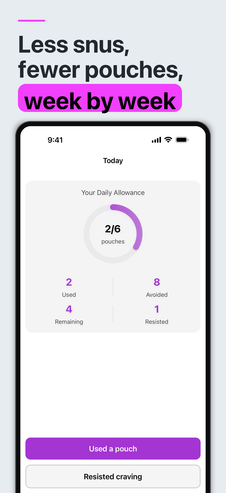
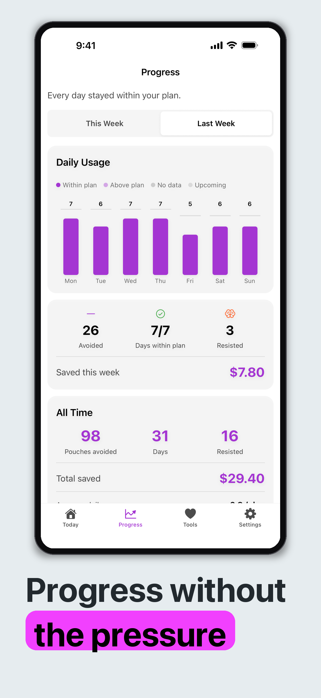

<picture>
  <source media="(prefers-color-scheme: dark)" srcset="assets/images/ios-dark.png">
  
</picture>

# Wean Nicotine

Reduce snus at your pace

<!-- IAMJARL README store block for Wean Nicotine (en). Generated from apps.json, v1.34.0. Do not edit. -->
<p>
  <a href="https://apps.apple.com/app/id6758867485?pt=128512007&amp;ct=github&amp;mt=8"><picture>
    <source media="(prefers-color-scheme: dark)" srcset="https://raw.githubusercontent.com/JarlLyng/iamjarl-design/v1.34.0/badges/app-store-white-en-us.svg">
    
  </picture></a>
  <br>
  $2.99 once · iOS 15.1 or later · <a href="https://weannicotine.iamjarl.com">weannicotine.iamjarl.com</a>
</p>

<p>
  
  
</p>

Wean Nicotine is for people who would rather cut down on snus and nicotine pouches a little at a time than stop overnight. You pick a pace, and your daily allowance steps down each week, in whole pouches. One tap logs a pouch or a craving you let pass, and a day over the limit is simply logged, with no streak to break and nothing to make up. Progress counts the pouches you've avoided and, if you add a price, the money saved. Your log stays on your iPhone, with no account, until you export it yourself.

## For developers

<p>
  <a href="https://madebyhuman.iamjarl.com"><picture>
    <source media="(prefers-color-scheme: dark)" srcset="https://madebyhuman.iamjarl.com/badges/co-created-white.svg">
    </picture></a>
  <a href="https://github.com/JarlLyng/wean-nicotine/actions/workflows/ci.yml"></a>
  <a href="LICENSE"></a>
</p>

The developer half: what's in the app, how to build and run it, how it is put together, how to contribute, and the license.

### What's in it

- **Onboarding:** your usual pouches a day, a pace from 3% to 15% a week with a preview of when the allowance reaches zero, an optional price per can, and the moments you usually reach for one.
- **Today:** the day's allowance as a whole number, one tap for _Used a pouch_ or _Resisted craving_, a 10-second undo, and an optional tag for what set a pouch off.
- **The plan:** a weekly reduction at the pace you chose. Baseline, pace and price can change in Settings without losing the log. If you run well above the plan for two weeks, Today offers to ease the pace, and stays quiet for a week if you dismiss it.
- **Progress:** each week's daily bars, pouches avoided against your starting point, money saved, gentle milestones, and a Patterns card for the time of day and the triggers behind your pouches.
- **Tools:** guided breathing, an urge-surfing timer, reflection prompts with an optional journal, and a savings calculator.
- **Settings:** optional local reminders, a light or dark appearance, Export Data as a CSV file, Send Feedback, and Start Over.
- **The end of the plan:** when the allowance reaches zero, Today marks it once, around the plan rather than a count of days.

There are no accounts, no cloud sync, no streak counter and no medical advice, by design. Anonymous crash reports go to Sentry, as the [privacy policy](https://weannicotine.iamjarl.com/privacy/) says. What's next is tracked in [GitHub Issues](https://github.com/JarlLyng/wean-nicotine/issues), and [`CHANGELOG.md`](CHANGELOG.md) has the history.

### Build and run

Prerequisites: Node 22 (`.nvmrc`), and Xcode for a development build.

```bash
npm install
npx expo start
```

Notifications need a development build, not Expo Go:

```bash
npx expo run:ios
```

`npm run check` runs lint, the type check and the tests, as CI does.

**Sentry is optional.** For development, copy `.env.example` to `.env` and set `EXPO_PUBLIC_SENTRY_DSN`; events are only logged to the console in development. Builds take the DSN from EAS environment variables, never from `.env`:

```bash
eas env:create --name EXPO_PUBLIC_SENTRY_DSN --value "https://your-dsn@xxx.ingest.sentry.io/xxx" --environment production --visibility plaintext
```

[`docs/SENTRY.md`](docs/SENTRY.md) covers the setup and how to check it. No secrets are stored in the repo.

**Releasing (iOS, bundle ID `com.iamjarl.taper`):**

1. Raise `ios.buildNumber` in `app.config.js` above the last upload, and `version` for a new release.
2. Build in the cloud and upload to App Store Connect:

   ```bash
   eas build --profile production --platform ios --auto-submit
   ```

   Add `--local` and leave out `--auto-submit` to build on your Mac instead, then upload the IPA with Transporter. `eas` is the globally installed eas-cli (`npm install -g eas-cli`); `npx eas` does not work in this repo.

3. Tag the release commit (`git tag -a vX.Y.Z -m "…"`) and push the tag. The Release workflow publishes the GitHub Release from that version's section of `CHANGELOG.md`.

The App Store screenshots are made as [`appstore/README.md`](appstore/README.md) describes.

### How it is put together

Expo SDK 55 on React Native's New Architecture, Expo Router, SQLite through `expo-sqlite` for everything the app stores, local notifications, and Sentry for crash reports. There is no backend. The app is iPhone only; the web target only renders the UI for design previews.

```
app/
  (onboarding)/          # welcome, baseline, pace, price, triggers
  (tabs)/
    home.tsx             # Today
    progress.tsx         # Progress
    tools/               # breathing, urge surfing, reflection, journal, savings
    settings/            # settings, edit plan, notifications, start over
components/              # UI, with reusable primitives in ui/
hooks/                   # useHomeData, useAppInitialize, keep-awake
lib/                     # the domain logic
  db*.ts                 # SQLite and its migrations
  taper-plan.ts          # the taper maths
  progress.ts            # progress and milestones
  export-csv.ts          # Export Data
  notifications.ts       # local reminders
  design.ts, theme.ts    # IAMJARL design tokens
appstore/                # App Store screenshots and how they're made
website/                 # the Astro site at weannicotine.iamjarl.com
docs/                    # architecture, decisions, store metadata
scripts/                 # maintainer tools
```

Start with [`docs/README.md`](docs/README.md) for the map of the docs and [`docs/ARCHITECTURE.md`](docs/ARCHITECTURE.md) for the architecture. [`docs/decisions/storage.md`](docs/decisions/storage.md) explains why everything lives in SQLite on the phone. The code is the source of truth for exact behaviour.

### Contributing

Issues and pull requests are welcome; [`CONTRIBUTING.md`](CONTRIBUTING.md) has the details, and [`SECURITY.md`](SECURITY.md) says how to report a vulnerability.

### License

[MIT](LICENSE) © 2026 IAMJARL.
